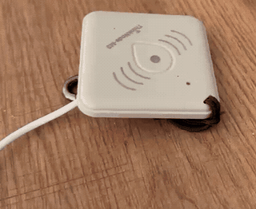
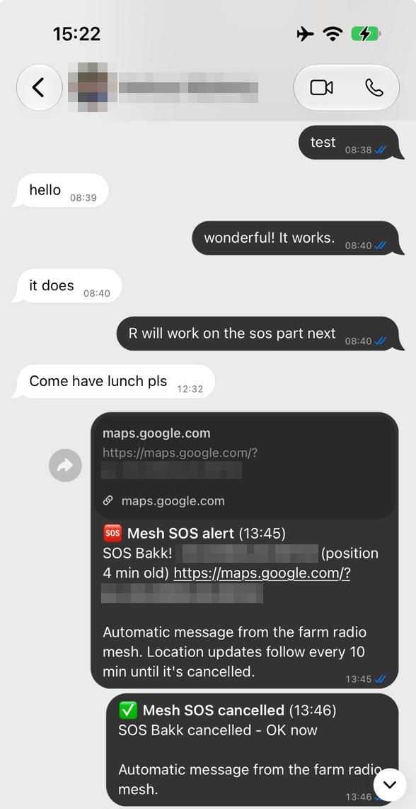

# ThinkNode SOS: a panic button for places with no signal

An unofficial fork of the [Meshtastic firmware](https://github.com/meshtastic/firmware)
(v2.7.26) that turns the button on an **Elecrow ThinkNode M3** into a hold-to-confirm
**SOS button**.

<p align="center">
  
</p>

> ⚠️ **This is not a certified emergency beacon.** An SOS only reaches people if the mesh
> reaches them. Test it where you'll use it, and never rely on it as your only way to call for help.

## Why

On a farm the house usually has internet, but out in the lands, the kloofs and the veld
there's often no cell signal at all. Two-way radios are the usual answer, but:

- **Someone has to be listening.** Radios aren't always monitored.
- **A call nobody hears is gone.** Nothing is waiting when someone gets back to the radio.
- **"I'm near the old dam" isn't a position.** Radios don't tell you where someone is.

A small LoRa mesh ([Meshtastic](https://meshtastic.org)) fills those gaps. Messages are
relayed from node to node until they arrive, and every node knows where it is. This build
puts a **panic button** on it that anyone can use: farm workers, family, guests, people
who'd never open a Meshtastic app. **Hold the button for 3 seconds.** Everyone on the mesh
gets an alert with a pin on the map, and with the gateway below, **so do their WhatsApps**.

The same mesh is handy every day too: farm-watch patrols, emergencies, or getting everyone
together for a braai after work.

## Why not the stock button

The stock Meshtastic detection sensor can send an alert from a button, but:

- It goes out as a sensor message. The Meshtastic iPhone app shows it and **never notifies**.
- It fires the moment the pin goes low. One bump sends it.
- The stock beeps (130–500 Hz) are quiet on the small piezo buzzer.
- It carries no location.

## What it does

| Action | Result |
|---|---|
| **Hold 3 s** | Ticks that speed up, then a loud confirm melody. **SOS sent** |
| Let go before 3 s | Nothing is sent |
| **Hold 3 s again** while an SOS is active | Cancelled: `✅ SOS <name> cancelled - OK now`, and the map pin is removed |
| Short press while another node's alarm sounds | Silences it |
| Double press | Sends position (stock behaviour) |
| 5 quick presses | Shutdown. Refused on USB power, while an SOS is active, and for 60 s after an alarm |

An SOS sends:

1. **A normal channel text**, so phone apps notify like any other message:
   `🆘 SOS <name>! -30.12345,25.12345 https://maps.google.com/?q=-30.12345,25.12345`,
   plus a bell character for nodes set up to alert on bells. If there's no GPS fix yet,
   the text says so. If the fix is old, it gives the age.
2. **A 🆘 waypoint pin** on everyone's map. It moves with each update, expires after 24 h,
   and is removed on cancel.
3. **A fresh position** update.
4. **A repeat every 2 minutes** until it's cancelled.

Other nodes running this build sound a **loud 30 s alarm** (2.3–3.4 kHz, near the
piezo's resonance) when they receive an SOS. Nodes running stock firmware just get the
text and the pin.

`<name>` is `detection_sensor.name` if you set one. Otherwise it's `SOS <short name>`. The button pin is
`detection_sensor.monitor_pin`, falling back to the board's user button (pin 12 on the M3).
To be a good neighbour on shared airwaves, the SOS is refused on the default public
channel. Use it on your own private channel.

## SOS to WhatsApp

In South Africa, and most of the world, **WhatsApp is how people actually get hold
of each other**. We run a companion gateway: a T-Beam on a home server hears the SOS on the
mesh and sends a WhatsApp to chosen family members or groups. The message includes the map
link, a location update every 10 min, and the cancel. Nobody needs a Meshtastic app for
this to work.

<p align="center">
  
</p>
<p align="center"><sub>A real alert arriving in a family WhatsApp chat. The name, photo and coordinates are blurred.</sub></p>

The gateway is **[veld-bridge](https://github.com/veld-mesh/veld-bridge)**. It also lets
you read and answer your WhatsApps from a pocket radio in the field.
**Signal and Telegram support are planned.**

## Build and flash

```bash
git clone -b thinknode-sos https://github.com/veld-mesh/thinknode-sos
cd thinknode-sos && git submodule update --init
pip install platformio meshtastic
pio run -e thinknode_m3_sos
meshtastic --port <PORT> --enter-dfu
```

Copy `.pio/build/thinknode_m3_sos/firmware-thinknode_m3_sos-*.uf2` onto the USB drive
that appears. Its `INFO_UF2.TXT` must say `ThinkNode-M3`. Your settings are kept. To go
back, flash the stock Meshtastic firmware the same way.

**If a node goes silent on USB:** a shutdown while on USB power can leave the nRF52 half
off. That's why this build refuses it. To recover, do a 1200-baud touch on the serial
port to reach the bootloader, then run
`adafruit-nrfutil dfu serial --package firmware-thinknode_m3_sos-*.zip -p <PORT> -b 115200 --singlebank`.

## What changed

All SOS code is behind `-DMESHTASTIC_SOS_BUTTON` and only built for env `thinknode_m3_sos`.

- `src/modules/SosModule.{h,cpp}`: the SOS module (it replaces the detection sensor in this build)
- `src/modules/Modules.cpp`: registers it
- `src/input/InputBroker.cpp`: removes the long-hold shutdown and its lead-up tune
- `src/input/ButtonThread.cpp`: turns triple-press GPS off, and adds the guarded 5-press shutdown
- `variants/nrf52840/ELECROW-ThinkNode-M3/platformio.ini`: the new env

A stock Meshtastic update replaces this firmware. We'll rebase onto new Meshtastic releases.

## Licence and credits

GPL-3.0, like Meshtastic. This is a modified version of Meshtastic firmware, and all
credit for everything else goes to the [Meshtastic](https://meshtastic.org) project and
its contributors. Meshtastic® is a registered trademark of Meshtastic LLC. This project is
not affiliated with or endorsed by Meshtastic.
